# WANT: Web Server & Recommendation System (Wolt Clone)

This project is an online food ordering system (named **Want**) that integrates a NodeJS/Express RESTful API web server with a high-performance C++ TCP Recommendation Engine backend and an interactive React frontend client. The Express web server manages online ordering features (users, restaurants, products, search, and orders) and utilizes an asynchronous TCP network socket client to update user views and purchase history in the C++ database to compile personalized recommendations.

---

## Architecture & Design Principles

The system is designed around clean separation of concerns, loose coupling, and SOLID principles. It splits responsibilities between the Node.js MVC/REST API web layer, the React user interface, and the legacy C++ recommender backend.

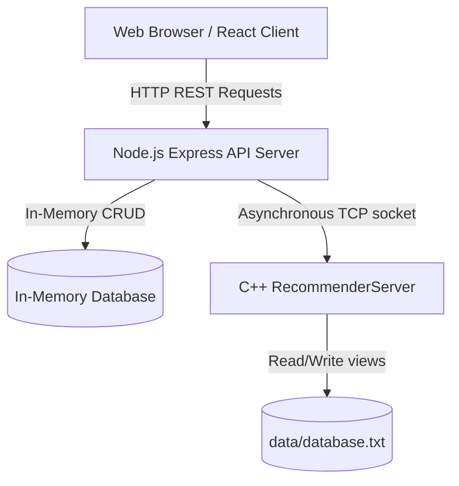

### Design Patterns & Architectural Layout:

*   **MVC Structure:** The Node.js web server implements an MVC-like pattern. Routers handle requests, Controllers contain business logic, and Models define entity schemas. The React frontend follows a component-driven architecture.
*   **Repository and Service Abstraction:** Temporary marketplace database collections (users, restaurants, products, and orders) are managed in-memory in [InMemoryDB.js](file:///c:/year2/advanced/WOLT/InMemoryDB.js), while the C++ TCP recommender remains responsible for storing and parsing product history.
*   **Dependency Isolation:** TCP integration is fully isolated inside [services/TCPClient.js](file:///c:/year2/advanced/WOLT/services/TCPClient.js). This ensures the Express controllers remain clean of raw socket handles or network retry logic.

---

## Assignment Integration & TCP Communications

The React frontend communicates with the Express REST API. Certain operations trigger asynchronous network requests to the C++ recommender server over TCP:

> [!NOTE]
> All previous assignment branches have been kept completely intact (`TARGIL-1`, `TARGIL-2`, `TARGIL-3`) and were not modified after submission.

*   **Operations that access the Express Web Server:**
    *   **User Management:** Signing up and Logging in.
    *   **Restaurants:** Creating, updating, viewing, and deleting restaurants (restricted to authenticated managers).
    *   **Products:** Creating, updating, viewing, and deleting products (restricted to authenticated managers).
    *   **Orders:** Placing, viewing, modifying items, and canceling orders.
    *   **Search:** Querying keywords globally.
    *   **Rating:** Submitting a restaurant rating (`POST /api/restaurants/:id/rate`, restricted to authenticated customers).
*   **Operations that access the C++ Recommender Server:**
    *   **View Product (`GET /api/restaurants/:restaurantId/products/:productId`):** Reports a product view to the user's history via `PATCH` (or fallback `POST` if the profile doesn't exist).
    *   **Create Order (`POST /api/orders`):** Reports a purchase of products to the C++ server.
    *   **Update Order (`PATCH /api/orders/:id`):** Synchronizes changed items to the C++ recommender (removing deleted items and reporting new ones).
    *   **Cancel Order (`DELETE /api/orders/:id`):** Removes purchase history of the canceled items from the C++ database.
*   **TCP Overlap Sync Logic:**
    When modifying or canceling an order, the system removes products from the C++ server history **only if** they are not present in any other active order placed by that specific user.

---

## Project Structure

*   [app.js](file:///c:/year2/advanced/WOLT/app.js) - Node.js Express server entry point (listens on port `1234`).
*   `routes/` - RESTful route maps:
    *   [orderRouter.js](file:///c:/year2/advanced/WOLT/routes/orderRouter.js)
    *   [restaurantRouter.js](file:///c:/year2/advanced/WOLT/routes/restaurantRouter.js)
    *   [searchRouter.js](file:///c:/year2/advanced/WOLT/routes/searchRouter.js)
    *   [userRouter.js](file:///c:/year2/advanced/WOLT/routes/userRouter.js)
    *   [existUserRouter.js](file:///c:/year2/advanced/WOLT/routes/existUserRouter.js)
*   `controllers/` - HTTP request controllers containing validation and authorization checks:
    *   [OrderController.js](file:///c:/year2/advanced/WOLT/controllers/OrderController.js)
    *   [ProductController.js](file:///c:/year2/advanced/WOLT/controllers/ProductController.js)
    *   [RestaurantController.js](file:///c:/year2/advanced/WOLT/controllers/RestaurantController.js)
    *   [SearchController.js](file:///c:/year2/advanced/WOLT/controllers/SearchController.js)
    *   [UserController.js](file:///c:/year2/advanced/WOLT/controllers/UserController.js)
*   `models/` - In-memory models and class definitions:
    *   [Order.js](file:///c:/year2/advanced/WOLT/models/Order.js)
    *   [Product.js](file:///c:/year2/advanced/WOLT/models/Product.js)
    *   [Restaurant.js](file:///c:/year2/advanced/WOLT/models/Restaurant.js)
    *   [User.js](file:///c:/year2/advanced/WOLT/models/User.js)
*   `services/` - Internal business services and TCP socket adapters:
    *   [TCPClient.js](file:///c:/year2/advanced/WOLT/services/TCPClient.js) (TCP network socket interface)
    *   [OrderService.js](file:///c:/year2/advanced/WOLT/services/OrderService.js)
    *   [ProductService.js](file:///c:/year2/advanced/WOLT/services/ProductService.js)
    *   [RestaurantService.js](file:///c:/year2/advanced/WOLT/services/RestaurantService.js)
    *   [SearchService.js](file:///c:/year2/advanced/WOLT/services/SearchService.js)
    *   [UserService.js](file:///c:/year2/advanced/WOLT/services/UserService.js)
*   `middlewares/` - Auth JWT tokens verification middleware.
*   `utils/` - Shared utility scripts:
    *   [location.js](file:///c:/year2/advanced/WOLT/utils/location.js) (Haversine formula coordinate distance calculator).
*   `src/` - Unified folder containing C++ Recommender logic and React component views:
    *   `src/components/Dashboard/` - React views (Dashboard, Header, Cart, OrderHistory, OwnerDashboard, theme styles).
    *   `src/context/` - Global authentication and styling state contexts.
    *   `src/core/` / `src/commands/` / `src/recommendation/` / `src/repository/` - C++ Server implementations.
*   `test/` - Node.js integration API tests and C++ unit tests.
*   `data/` - Mount path for recommendation log database (`database.txt`).

---

## Getting Started

### Prerequisites

*   **Docker Desktop:** Configured to run Linux containers.
*   **Node.js / npm:** For local compilation and dev commands.

---

### Run via Docker Compose (Recommended)

> [!CAUTION]
> **Ensure Docker Desktop is Running:** If you receive a connection error like `failed to connect to the docker API`, it means your Docker Desktop application is turned off. Open **Docker Desktop** on Windows and wait for the status bar at the bottom left to turn green before running the commands below.

1.  **Build all containers:**
    ```bash
    docker compose build
    ```
    This builds the C++ Recommender server, compiles dependencies, installs NodeJS modules, and prepares the bundle.

2.  **Start all containers together:**
    ```bash
    docker compose up
    ```
    This launches:
    *   `server` - C++ Recommender server listening internally on port `5555`.
    *   `web` - NodeJS web server running on host port `1234`.
    *   `client` - Interactive Python terminal.

3.  **Important socket note:**
    The C++ Recommender server accepts only one connection at a time. The `client` container holds the socket open. **To allow the web application to submit TCP recommendation views and purchases, shut down the client container:**
    ```bash
    docker compose stop client
    ```

4.  **Open the application:**
    Open your browser and navigate to:
    ```
    http://localhost:1234
    ```

5.  **Stop containers and clear volumes:**
    ```bash
    docker compose down
    ```

---

### Run Locally (Without Docker)

#### A. Compile and Start the C++ Recommender Server
```bash
./wolt_recommender_app 5555
```

#### B. Build React Assets and Start the NodeJS Web Server
In a separate terminal root:
```bash
npm install
npm run build
node app.js
```
The application will run live at `http://localhost:1234`.


## Environment Variables & Configuration

The application parses specific environment variables to link services (configured in [docker-compose.yml](file:///c:/year2/advanced/WOLT/docker-compose.yml)):
*   `TCP_HOST`: Host location of the C++ recommender server (defaults to `'localhost'`, or `'server'` inside Docker).
*   `TCP_PORT`: Port number of the C++ recommendation engine (defaults to `5555`).

---

## Program Usage & Operations

1.  **SIGN UP:** Register a customer or manager profile. Registration checks email patterns, passwords match, a 10-digit phone number validation, coordinates, and avatar images.
2.  **LOGIN:** Provides token authorization keys.
3.  **CREATE RESTAURANT:** Managers can build store listings with locations, photos, and categories.
4.  **UPDATE RESTAURANT:** Managers can modify their own store details.
5.  **DELETE RESTAURANT:** Managers can remove restaurants they own.
6.  **ADD/UPDATE/DELETE PRODUCTS:** Managers can update menu items.
7.  **VIEW RESTAURANT MENU:** Customers can browse menus, adding items to the cart.
8.  **VIEW PRODUCT DETAILS:** Triggers a product view interaction report to the C++ server.
9.  **CREATE ORDER:** Customers submit checkout orders containing item arrays.
10. **UPDATE ORDER:** Customers can add/delete items and adjust quantities inside past orders.
11. **CANCEL ORDER:** Customers can delete placed orders.
12. **SEARCH:** Global query searching matching restaurant titles, tags, and product names.
13. **RATE RESTAURANT:** Customers can submit or update a 1 to 5 star rating for any restaurant, which dynamically updates its average rating score.

---

## Additional Features & Premium Aesthetics

*   **Interactive Rating System:** Customers can hover and click on stars (1 to 5 scale) on either the restaurant card on the dashboard or inside the restaurant's menu page to rate/update reviews.
*   **Dynamic Sorting Panel:** The dashboard features a dropdown menu to sort restaurants by **Popularity** (based on dynamic order counts), **Rating ⭐** (average score), **Distance 📍** (using coordinates), or **Alphabetical (A-Z) 🔤** (supporting English and Hebrew).
*   **Dark Mode Toggle:** Logged-in users can switch between a beautiful light and dark layout globally via a top bar button.
*   **Geolocation Distance Calculation:** Displays real-time distances in kilometers between the user's registered location and each restaurant using the **Haversine formula**.
*   **Infinite Categories Marquee:** A looping horizontal crave-list categories marquee that dynamically pauses on hover.
*   **X-User-ID Security & Role-Based Middleware:** Auth rules prevent normal customers from accessing owner dashboard operations, and enforce strict ownership checks before altering restaurants or products.

---

## Quick step-by-step Tutorial

### 1. As a Restaurant Owner/Manager

1. **Register:** Create a manager profile. Fill out all fields, including the required profile avatar image.
   
   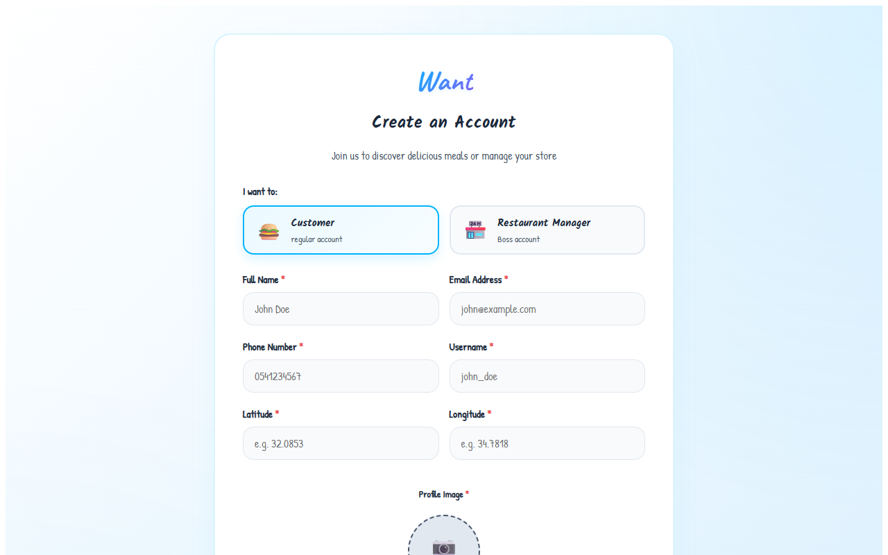

2. **Login:** Log in with manager credentials to access the **Partner Dashboard**.
   
   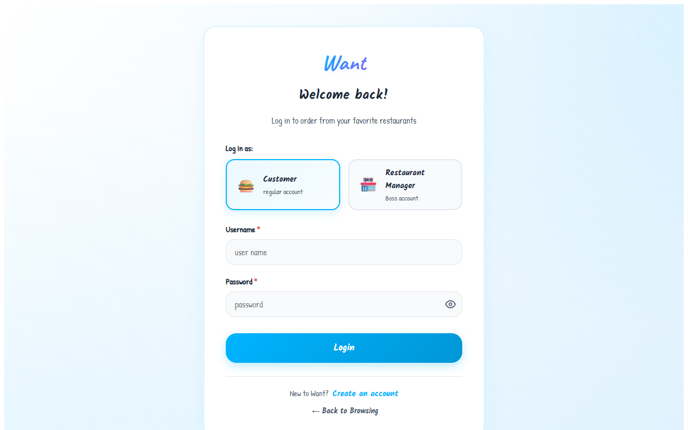
   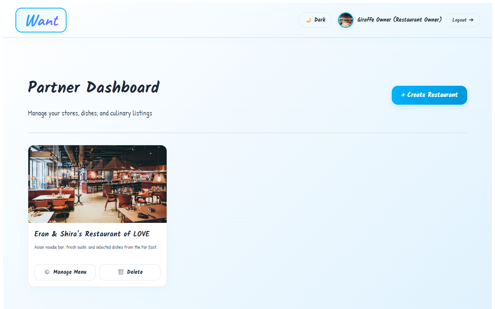

3. **Create Restaurant:** Click "+ Create Restaurant" to open the registration form.
   
   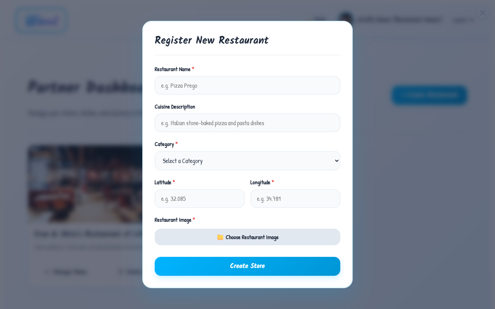

4. **Manage Menu:** Click "Manage Menu" to open your store's private menu manager where you can add new dishes, adjust prices, edit items, or delete products.
   
   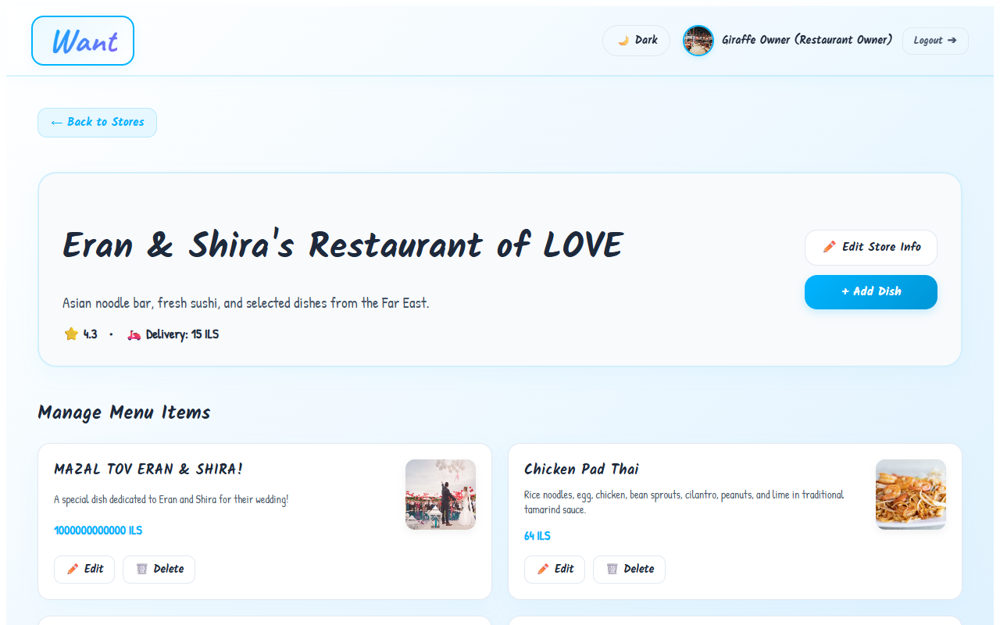
   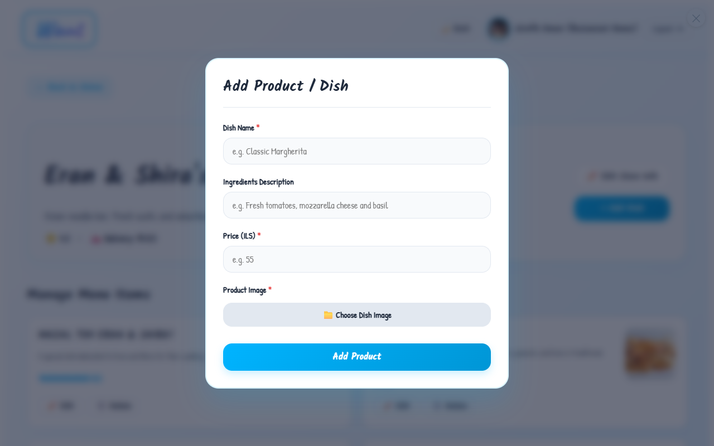

---

### 2. As a Customer

1. **Marketplace & Filters:** Search for keywords, filter by category tags, or sort restaurants using the popularity, rating, or distance sorting dropdowns.
   
   

2. **Global Search:** Find specific restaurants or dishes matching your search query instantly.
   
   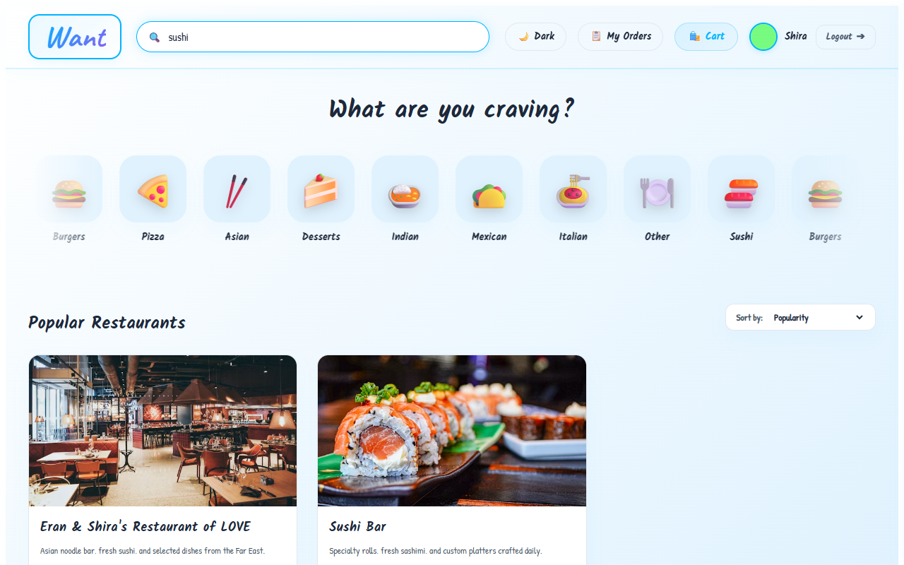

3. **Restaurant Menu:** Browse menu items at any restaurant.
   
   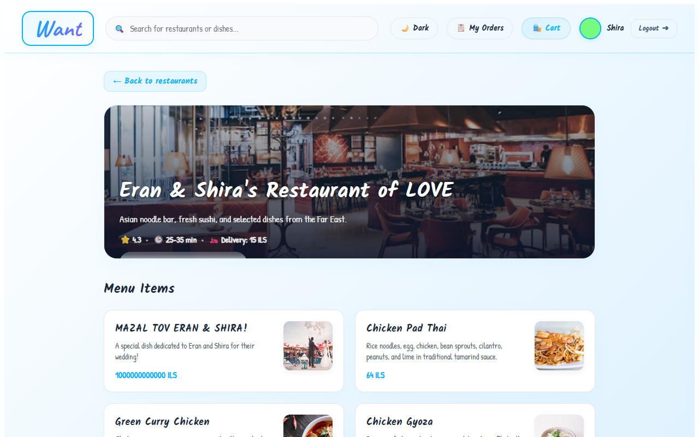

4. **Dish Details Modal:** Click on a product card to open details and configure order quantities.
   
   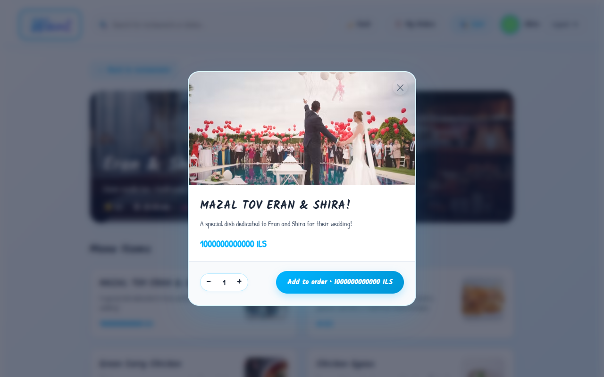

5. **Shopping Cart Drawer:** Review selected items in your slide-out cart drawer, view delivery fees, and check out.
   
   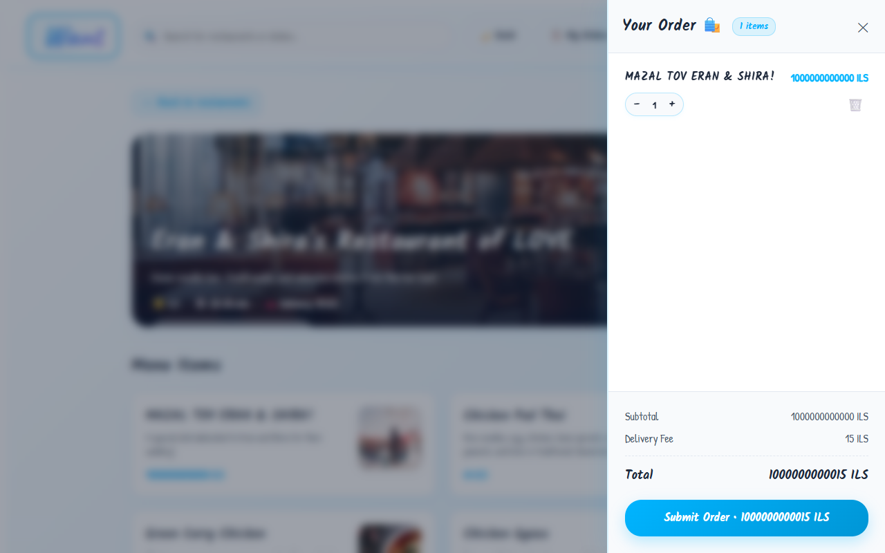

6. **Order History:** Navigate to the "My Orders" tab to review past orders, adjust quantities, or cancel/delete orders.
   
   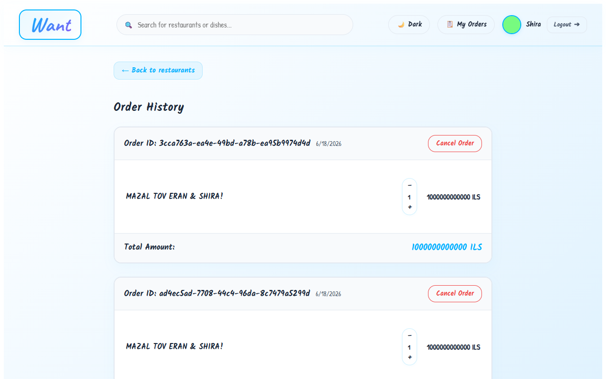

7. **Theme Switch:** Switch between Light and Dark modes.
   
   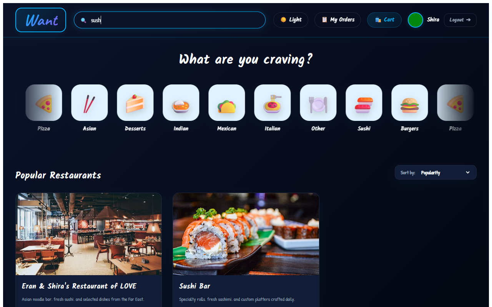

8. **User Profile Panel:** Click on your profile card to view personal details.
   
   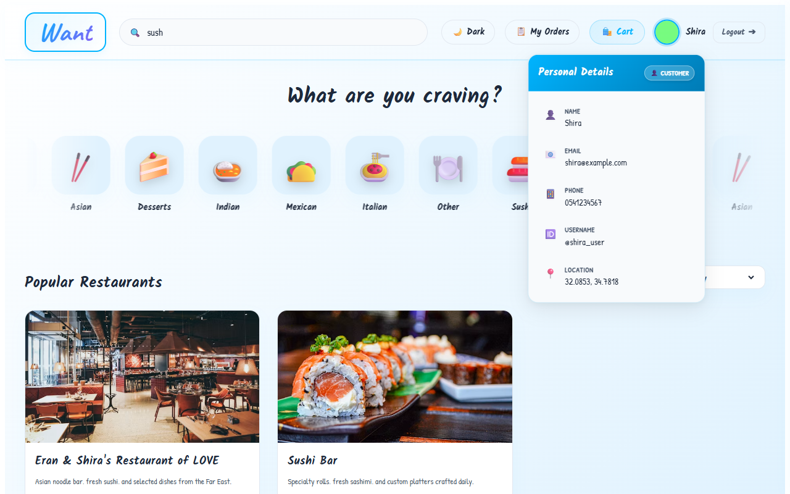

9. **404 Not Found Page:** Navigating to an invalid URL triggers the redirect screen.
   
   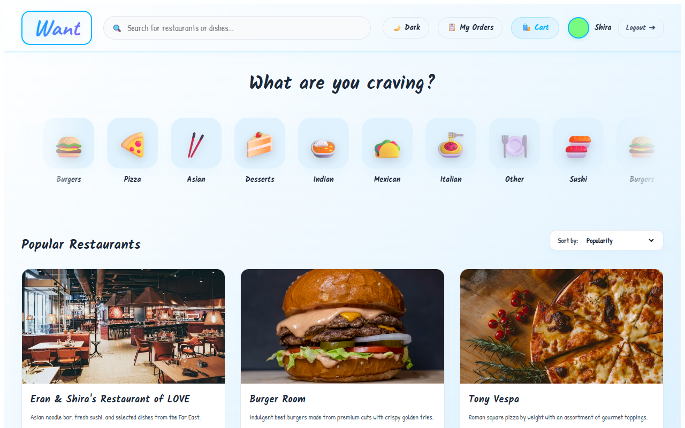

---

## Implementation Notes

*   **In-Memory Storage:** All web application data (excluding user recommendation view and purchase log database in `data/database.txt`) is stored in-memory inside the NodeJS server. Restarting the web container or terminal command cleans database arrays.
*   **Max payload limit:** Request JSON bodies and avatars are limited to 10MB to maintain responsive operations.
*   **Default Seed Accounts:** Default manager profiles exist for testing. You can log in using `Password123` to manage pre-seeded restaurants:
    *   `giraffe_owner` (Manages *"Eran & Shira's Restaurant of LOVE*)
    *   `burger_owner` (Manages *"Burger Room"*)
    *   `pizza_owner` (Manages *"Tony Vespa"*)
    *   `sushi_owner` (Manages *"Sushi Bar"*)
    *   `desserts_owner` (Manages *"Sweet Creations"*)
    *   `indian_owner` (Manages *"Taj Mahal"*)
    *   `mexican_owner` (Manages *"La Taqueria"*)
    *   `italian_owner` (Manages *"Trattoria Bella"*)
