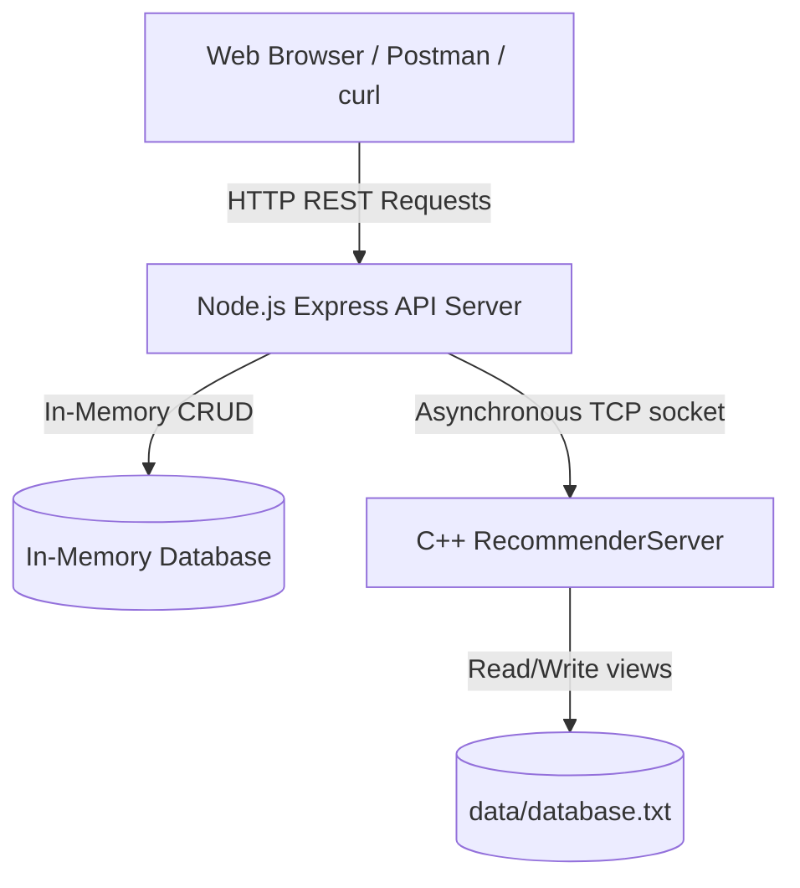

# Wolt REST API & Recommendation Server (Exercise 3)

This project integrates a RESTful API Web Server (built with Node.js & Express) with a high-performance C++ Recommendation Engine. The Express web server manages online ordering features (users, restaurants, products, search, and orders) and uses an asynchronous TCP network client to update user views and purchase history in the C++ backend for personalized recommendations.

---

## System Architecture



* **Node.js Web Server:** Exposes RESTful endpoints, handles parameter validation, performs security checks (restaurant ownership), and dispatches network interactions in the background to the C++ server.
* **C++ Recommender Server:** Listens on port `5555` over TCP. It parses user interaction histories, stores them in `data/database.txt`, and computes recommendations.
* **Asynchronous TCP client:** Embedded in Node.js to communicate with the C++ server. If the C++ server is offline, connection errors are logged gracefully without blocking or crashing HTTP requests.

---

## Docker & Execution Instructions

You can run the application either using Docker Compose (recommended) or locally from your terminal.

### 1. Run the Entire Stack via Docker Compose (Recommended)
Open a terminal (Command Prompt, PowerShell, or WSL) in the project root directory and run:

```bash
docker compose up --build
```

This command automatically builds and launches three containers:
* **server:** C++ Recommender Server listening on port `5555` inside the container (mapped to host port `5555`).
* **web:** Node.js Web App listening on port `1234` inside the container (mapped to host port `1234`).
* **client:** An interactive Python client container.

> [!IMPORTANT]
> The C++ Recommender Server is single-threaded and accepts only one connection at a time. The Python `client` container holds the connection open on startup while waiting for input. **To test the Node.js API server's TCP calls, stop the client container to free up the C++ server socket:**
> ```bash
> docker compose stop client
> ```

To shut down all containers and clean up volumes:
```bash
docker compose down
```

---

### 2. Run Locally (Without Docker)

#### A. Start the C++ Recommender Server
Open your WSL (Windows Subsystem for Linux) or Linux terminal, build the binary if needed:
```bash
g++ -std=c++17 src/main.cpp src/server/RecommenderServer.cpp src/recommendation/RecommendationEngine.cpp src/utils/ValidationUtils.cpp -o wolt_recommender_app -lpthread
```
Run the recommender server executable on port `5555`:
```bash
./wolt_recommender_app 5555
```

#### B. Start the Node.js API Server
Open a terminal in the project root directory (WSL, Command Prompt, or PowerShell) and run:
```bash
# Install NPM dependencies
npm install

# Start the Express server
node app.js
```
The server runs live at `http://localhost:1234/api`.

#### C. Run Tests
To verify all integrations, schemas, and models (without Docker):
```bash
# Make sure your execution policy allows scripts (e.g. in WSL or PowerShell run tests directly)
npm test
```

---

## REST API Specifications & Run Examples

All API requests must use the base URL: `http://localhost:1234/api`

> 

---

### 1. User Authentication API (`/api/users` & `/api/tokens`)

#### A. User Registration (Create User)
* **Method & Path:** `POST /api/users`
* **Headers:** 
  * `Content-Type: application/json`
* **Request Body Fields:**
  * `name` (String, required): Full name of the user.
  * `email` (String, required): Email address.
  * `phone` (String, required): 10-digit phone number (validation: must be exactly 10 digits, e.g., `0541234567`).
  * `address` (String, required): Physical home/work address.
  * `userName` (String, required): Unique username used to log in.
  * `password` (String, required): User password.
* **Run Example (curl):**
  ```bash
  curl -X POST http://localhost:1234/api/users \
    -H "Content-Type: application/json" \
    -d '{
      "name": "Shira",
      "email": "shira@example.com",
      "phone": "0541234567",
      "address": "Dizengoff 100",
      "userName": "shira_123",
      "password": "password123"
    }'
  ```
* **Expected Responses:**
  * `201 Created`: User created successfully. Returns an empty body and a `Location` header pointing to the new user resource (e.g., `Location: /api/users/user_uuid_here`).
  * `400 Bad Request`: Missing mandatory fields, or phone number length is not exactly 10 digits.
  * `409 Conflict`: The username (`userName`) is already taken.

#### B. User Login (Generate Token)
* **Method & Path:** `POST /api/tokens`
* **Headers:** 
  * `Content-Type: application/json`
* **Request Body Fields:**
  * `userName` (String, required): The registered username.
  * `password` (String, required): The registered password.
* **Run Example (curl):**
  ```bash
  curl -X POST http://localhost:1234/api/tokens \
    -H "Content-Type: application/json" \
    -d '{
      "userName": "shira_123",
      "password": "password123"
    }'
  ```
* **Expected Responses:**
  * `200 OK`: Valid credentials. Returns the user's ID as a token:
    ```json
    { "id": "user_uuid_here" }
    ```
  * `401 Unauthorized`: Invalid username or password.

#### C. Get User Profile
* **Method & Path:** `GET /api/users/:id`
* **Path Parameters:**
  * `:id` (String, required): The UUID of the user to fetch.
* **Run Example (curl):**
  ```bash
  curl -X GET http://localhost:1234/api/users/user_uuid_here
  ```
* **Expected Responses:**
  * `200 OK`: Returns the profile info (excluding password for security):
    ```json
    {
      "id": "user_uuid_here",
      "name": "Shira",
      "email": "shira@example.com",
      "phone": "0541234567",
      "address": "Dizengoff 100",
      "userName": "shira_123"
    }
    ```
  * `404 Not Found`: User does not exist.

---

### 2. Restaurants API (`/api/restaurants`)

#### A. Create Restaurant
* **Method & Path:** `POST /api/restaurants`
* **Headers:** 
  * `Content-Type: application/json`
  * `x-user-id: <user_id>` (String, required: The owner user UUID)
* **Request Body Fields:**
  * `name` (String, required): The name of the restaurant.
  * `description` (String, optional): Description of the culinary style/cuisine.
* **Run Example (curl):**
  ```bash
  curl -X POST http://localhost:1234/api/restaurants \
    -H "Content-Type: application/json" \
    -H "x-user-id: user_uuid_here" \
    -d '{
      "name": "Giraffe",
      "description": "Asian Noodle Bar"
    }'
  ```
* **Expected Responses:**
  * `201 Created`: Restaurant created. Returns empty body and `Location: /api/restaurants/restaurant_uuid_here`.
  * `400 Bad Request`: Missing restaurant name.
  * `401 Unauthorized`: Missing `x-user-id` header.
  * `404 Not Found`: Owner user ID in `x-user-id` header does not exist in database.

#### B. Retrieve All Restaurants / Filtering
* **Method & Path:** `GET /api/restaurants`
* **Query Parameters:**
  * `q` or `search` (String, optional): Search term to filter restaurants by name or description.
* **Run Example (curl):**
  ```bash
  # Retrieve all restaurants
  curl -X GET http://localhost:1234/api/restaurants

  # Search for restaurants containing "Asian"
  curl -X GET "http://localhost:1234/api/restaurants?q=Asian"
  ```
* **Expected Responses:**
  * `200 OK`: Returns an array of restaurants matching search, or all restaurants if no query param is provided:
    ```json
    [
      {
        "id": "restaurant_uuid_here",
        "name": "Giraffe",
        "description": "Asian Noodle Bar",
        "ownerId": "user_uuid_here"
      }
    ]
    ```

#### C. Retrieve Restaurant by ID
* **Method & Path:** `GET /api/restaurants/:id`
* **Path Parameters:**
  * `:id` (String, required): The UUID of the restaurant.
* **Run Example (curl):**
  ```bash
  curl -X GET http://localhost:1234/api/restaurants/restaurant_uuid_here
  ```
* **Expected Responses:**
  * `200 OK`: Returns the restaurant object:
    ```json
    {
      "id": "restaurant_uuid_here",
      "name": "Giraffe",
      "description": "Asian Noodle Bar",
      "ownerId": "user_uuid_here"
    }
    ```
  * `404 Not Found`: Restaurant not found.

#### D. Update Restaurant
* **Method & Path:** `PATCH /api/restaurants/:id`
* **Headers:**
  * `Content-Type: application/json`
  * `x-user-id: <user_id>` (String, required: The owner's user ID for verification)
* **Path Parameters:**
  * `:id` (String, required): The UUID of the restaurant.
* **Request Body Fields:**
  * `name` (String, optional): Updated restaurant name.
  * `description` (String, optional): Updated restaurant description.
* **Run Example (curl):**
  ```bash
  curl -X PATCH http://localhost:1234/api/restaurants/restaurant_uuid_here \
    -H "Content-Type: application/json" \
    -H "x-user-id: user_uuid_here" \
    -d '{
      "name": "Giraffe Noodle Bar",
      "description": "Premium Asian noodle bar"
    }'
  ```
* **Expected Responses:**
  * `204 No Content`: Updated successfully.
  * `401 Unauthorized`: Missing `x-user-id` header.
  * `403 Forbidden`: User is not the owner of this restaurant.
  * `404 Not Found`: Restaurant or owner user not found.

#### E. Delete Restaurant
* **Method & Path:** `DELETE /api/restaurants/:id`
* **Headers:**
  * `x-user-id: <user_id>` (String, required: The owner's user ID for verification)
* **Path Parameters:**
  * `:id` (String, required): The UUID of the restaurant.
* **Run Example (curl):**
  ```bash
  curl -X DELETE http://localhost:1234/api/restaurants/restaurant_uuid_here \
    -H "x-user-id: user_uuid_here"
  ```
* **Expected Responses:**
  * `204 No Content`: Restaurant deleted successfully.
  * `401 Unauthorized`: Missing `x-user-id` header.
  * `403 Forbidden`: User is not the owner of this restaurant.
  * `404 Not Found`: Restaurant not found.

---

### 3. Products API (`/api/restaurants/:restaurantId/products`)

#### A. Add Product
* **Method & Path:** `POST /api/restaurants/:restaurantId/products`
* **Headers:** 
  * `Content-Type: application/json`
  * `x-user-id: <user_id>` (String, required: The owner's user ID for verification)
* **Path Parameters:**
  * `:restaurantId` (String, required): The UUID of the restaurant to add this product to.
* **Request Body Fields:**
  * `name` (String, required): Product name.
  * `description` (String, optional): Product description.
  * `price` (Number, required): Cost of the product (must be greater than 0).
* **Run Example (curl):**
  ```bash
  curl -X POST http://localhost:1234/api/restaurants/restaurant_uuid_here/products \
    -H "Content-Type: application/json" \
    -H "x-user-id: user_uuid_here" \
    -d '{
      "name": "Salmon Sushi",
      "description": "Sushi roll",
      "price": 60
    }'
  ```
* **Expected Responses:**
  * `201 Created`: Product created. Returns empty body and `Location: /api/restaurants/restaurant_uuid/products/product_uuid_here`.
  * `400 Bad Request`: Missing name or price, or invalid price value.
  * `401 Unauthorized`: Missing `x-user-id` header.
  * `403 Forbidden`: User is not the owner of this restaurant.
  * `404 Not Found`: Restaurant not found.

#### B. Retrieve Menu (All Products of Restaurant)
* **Method & Path:** `GET /api/restaurants/:restaurantId/products`
* **Path Parameters:**
  * `:restaurantId` (String, required): The UUID of the restaurant.
* **Run Example (curl):**
  ```bash
  curl -X GET http://localhost:1234/api/restaurants/restaurant_uuid_here/products
  ```
* **Expected Responses:**
  * `200 OK`: Returns an array of products for the given restaurant:
    ```json
    [
      {
        "id": "product_uuid_here",
        "name": "Salmon Sushi",
        "description": "Sushi roll",
        "price": 60,
        "restaurantId": "restaurant_uuid_here"
      }
    ]
    ```
  * `404 Not Found`: Restaurant not found.

#### C. Retrieve Product Details (Reports View to C++)
* **Method & Path:** `GET /api/restaurants/:restaurantId/products/:productId`
* **Headers (Optional):**
  * `x-user-id: <user_id>` (String: The user viewing the product. If passed, it triggers a view report to the C++ server via TCP)
* **Path Parameters:**
  * `:restaurantId` (String, required): The UUID of the restaurant.
  * `:productId` (String, required): The UUID of the product.
* **Run Example (curl):**
  ```bash
  curl -X GET http://localhost:1234/api/restaurants/restaurant_uuid_here/products/product_uuid_here \
    -H "x-user-id: user_uuid_here"
  ```
* **Expected Responses:**
  * `200 OK`: Returns product details:
    ```json
    {
      "id": "product_uuid_here",
      "name": "Salmon Sushi",
      "description": "Sushi roll",
      "price": 60,
      "restaurantId": "restaurant_uuid_here"
    }
    ```
  * `404 Not Found`: Product or Restaurant not found.

#### D. Update Product
* **Method & Path:** `PATCH /api/restaurants/:restaurantId/products/:productId`
* **Headers:** 
  * `Content-Type: application/json`
  * `x-user-id: <user_id>` (String, required: The owner's user ID for verification)
* **Path Parameters:**
  * `:restaurantId` (String, required): The UUID of the restaurant.
  * `:productId` (String, required): The UUID of the product.
* **Request Body Fields:**
  * `name` (String, optional): Updated product name.
  * `description` (String, optional): Updated product description.
  * `price` (Number, optional): Updated product price.
* **Run Example (curl):**
  ```bash
  curl -X PATCH http://localhost:1234/api/restaurants/restaurant_uuid_here/products/product_uuid_here \
    -H "Content-Type: application/json" \
    -H "x-user-id: user_uuid_here" \
    -d '{
      "name": "Salmon Sushi Deluxe",
      "price": 65
    }'
  ```
* **Expected Responses:**
  * `204 No Content`: Product updated successfully.
  * `401 Unauthorized`: Missing `x-user-id` header.
  * `403 Forbidden`: User is not the owner of this restaurant.
  * `404 Not Found`: Product or Restaurant not found.

#### E. Delete Product
* **Method & Path:** `DELETE /api/restaurants/:restaurantId/products/:productId`
* **Headers:**
  * `x-user-id: <user_id>` (String, required: The owner's user ID for verification)
* **Path Parameters:**
  * `:restaurantId` (String, required): The UUID of the restaurant.
  * `:productId` (String, required): The UUID of the product.
* **Run Example (curl):**
  ```bash
  curl -X DELETE http://localhost:1234/api/restaurants/restaurant_uuid_here/products/product_uuid_here \
    -H "x-user-id: user_uuid_here"
  ```
* **Expected Responses:**
  * `204 No Content`: Product deleted successfully.
  * `401 Unauthorized`: Missing `x-user-id` header.
  * `403 Forbidden`: User is not the owner of this restaurant.
  * `404 Not Found`: Product or Restaurant not found.

---

### 4. Orders API (`/api/orders`)

#### A. Create Order (Reports Purchase to C++)
* **Method & Path:** `POST /api/orders`
* **Headers:**
  * `Content-Type: application/json`
  * `x-user-id: <user_id>` (String, required: UUID of the ordering user)
* **Request Body Fields:**
  * `restaurantId` (String, required): Restaurant UUID.
  * `items` (Array, required): Array of products to buy. Each item requires:
    * `productId` (String, required): Product UUID.
    * `quantity` (Integer, required): Must be a positive integer.
* **Run Example (curl):**
  ```bash
  curl -X POST http://localhost:1234/api/orders \
    -H "Content-Type: application/json" \
    -H "x-user-id: user_uuid_here" \
    -d '{
      "restaurantId": "restaurant_uuid_here",
      "items": [
        {
          "productId": "product_uuid_here",
          "quantity": 2
        }
      ]
    }'
  ```
* **Expected Responses:**
  * `201 Created`: Order created successfully. Returns the order object and triggers an asynchronous `reportInteraction` to the C++ server.
    ```json
    {
      "id": "order_uuid_here",
      "userId": "user_uuid_here",
      "restaurantId": "restaurant_uuid_here",
      "items": [
        {
          "productId": "product_uuid_here",
          "quantity": 2
        }
      ],
      "total": 120
    }
    ```
  * `400 Bad Request`: Missing headers, invalid quantity, or product does not exist in the restaurant.
  * `404 Not Found`: User or Restaurant not found.

#### B. Get Order History of Current User
* **Method & Path:** `GET /api/orders`
* **Headers:**
  * `x-user-id: <user_id>` (String, required: The UUID of the user)
* **Run Example (curl):**
  ```bash
  curl -X GET http://localhost:1234/api/orders \
    -H "x-user-id: user_uuid_here"
  ```
* **Expected Responses:**
  * `200 OK`: Returns an array of the user's orders:
    ```json
    [
      {
        "id": "order_uuid_here",
        "userId": "user_uuid_here",
        "restaurantId": "restaurant_uuid_here",
        "items": [
          {
            "productId": "product_uuid_here",
            "quantity": 2
          }
        ],
        "total": 120
      }
    ]
    ```
  * `400 Bad Request`: Missing `x-user-id` header.

#### C. Get Order Details by ID
* **Method & Path:** `GET /api/orders/:id`
* **Path Parameters:**
  * `:id` (String, required): The UUID of the order.
* **Run Example (curl):**
  ```bash
  curl -X GET http://localhost:1234/api/orders/order_uuid_here
  ```
* **Expected Responses:**
  * `200 OK`: Returns the order details:
    ```json
    {
      "id": "order_uuid_here",
      "userId": "user_uuid_here",
      "restaurantId": "restaurant_uuid_here",
      "items": [
        {
          "productId": "product_uuid_here",
          "quantity": 2
        }
      ],
      "total": 120
    }
    ```
  * `404 Not Found`: Order not found.

#### D. Update Order Items (TCP Overlap Sync)
* **Method & Path:** `PATCH /api/orders/:id`
* **Headers:**
  * `Content-Type: application/json`
  * `x-user-id: <user_id>` (String, required: The user's UUID)
* **Path Parameters:**
  * `:id` (String, required): The UUID of the order.
* **Request Body Fields:**
  * `items` (Array, required): The updated full list of items:
    * `productId` (String, required): Product UUID.
    * `quantity` (Integer, required): Must be a positive integer.
* **Run Example (curl):**
  ```bash
  curl -X PATCH http://localhost:1234/api/orders/order_uuid_here \
    -H "Content-Type: application/json" \
    -H "x-user-id: user_uuid_here" \
    -d '{
      "items": [
        {
          "productId": "product_uuid_here",
          "quantity": 3
        }
      ]
    }'
  ```
* **Expected Responses:**
  * `204 No Content`: Order items updated successfully.
  * `404 Not Found`: Order not found or validation failed.
  * **C++ TCP Synchronization:** Re-calculates total. Removes old items from the C++ database **only if** they do not overlap (exist in) any of the user's other active orders, and reports the new items.

#### E. Cancel/Delete Order (TCP Overlap Sync)
* **Method & Path:** `DELETE /api/orders/:id`
* **Headers:**
  * `x-user-id: <user_id>` (String, required: The user's UUID)
* **Path Parameters:**
  * `:id` (String, required): The UUID of the order.
* **Run Example (curl):**
  ```bash
  curl -X DELETE http://localhost:1234/api/orders/order_uuid_here \
    -H "x-user-id: user_uuid_here"
  ```
* **Expected Responses:**
  * `204 No Content`: Order deleted successfully.
  * `404 Not Found`: Order not found.
  * **C++ TCP Synchronization:** Deletes items from C++ database **only if** they are not present in any other active order of this user.

---

### 5. Global Search API (`/api/search/:query`)

* **Method & Path:** `GET /api/search/:query`
* **Path Parameters:**
  * `:query` (String, required): The search string.
* **Run Example (curl):**
  ```bash
  curl -X GET http://localhost:1234/api/search/sushi
  ```
* **Expected Responses:**
  * `200 OK`: Returns a structured JSON matching the query against restaurant names, descriptions, and product names:
    ```json
    {
      "restaurants": [
        {
          "id": "restaurant_uuid_here",
          "name": "Giraffe",
          "description": "Asian Noodle Bar",
          "ownerId": "user_uuid_here"
        }
      ],
      "products": [
        {
          "id": "product_uuid_here",
          "name": "Salmon Sushi",
          "description": "Sushi roll",
          "price": 60,
          "restaurantId": "restaurant_uuid_here"
        }
      ]
    }
    ```

---

## C++ TCP Server Protocol Specification

When Node.js communicates with the C++ server on port `5555`, it sends space-separated commands terminated by `\n`. Product IDs are treated as valid non-empty string IDs (excluding whitespace):

1. **POST (Register/Initialize profile):**
   ```
   POST [userid] [productid1] [productid2] ...
   ```
   *Response:* `201 Created` on success, or `404 Not Found` (meaning user already exists).

2. **PATCH (Append interaction views):**
   ```
   PATCH [userid] [productid1] [productid2] ...
   ```
   *Response:* `204 No Content` on success, or `404 Not Found` if user does not exist.

3. **DELETE (Remove product views):**
   ```
   DELETE [userid] [productid1] [productid2] ...
   ```
   *Response:* `204 No Content` on success, or `404 Not Found` if user or any product doesn't exist.

4. **GET (Get Recommendation):**
   ```
   GET [userid] [productid]
   ```
   *Response:* `200 Ok\n\n[space-separated recommended product IDs]`.
