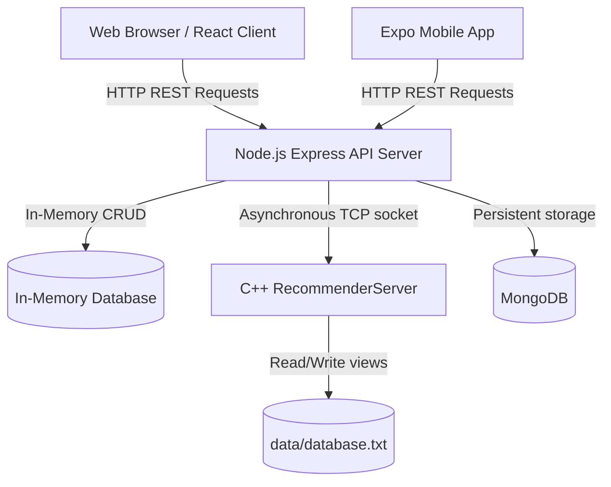

# Home — System Overview & Environment Setup

This wiki provides comprehensive documentation for the **WANT** food ordering system — a full-stack Wolt clone integrating a Node.js/Express REST API, a C++ TCP Recommendation Engine, a React web client, and an Expo (React Native) mobile app.

---

## Table of Contents
- [Architecture](#architecture)
- [Project Structure](#project-structure)
- [Prerequisites](#prerequisites)
- [Running the Entire System with Docker Compose](#running-the-entire-system-with-docker-compose)
- [Running Locally (Without Docker)](#running-locally-without-docker)
- [Environment Variables](#environment-variables)
- [Wiki Navigation](#wiki-navigation)

---

## Architecture

The system is designed around clean separation of concerns, loose coupling, and SOLID principles. It splits responsibilities between the Node.js MVC/REST API web layer, the React user interface, and the legacy C++ recommender backend.



### Key Design Patterns

* **MVC Structure:** The Node.js web server implements an MVC-like pattern — Routers handle requests, Controllers contain business logic, and Models define entity schemas. The React frontend follows a component-driven architecture.
* **Repository and Service Abstraction:** Marketplace database collections (users, restaurants, products, and orders) are managed in-memory in `InMemoryDB.js`, while the C++ TCP recommender stores and parses product history.
* **Dependency Isolation:** TCP integration is fully isolated inside `services/TCPClient.js`, keeping Express controllers clean of raw socket handles or network retry logic.

### TCP Communication Flow

Certain operations trigger asynchronous network requests to the C++ recommender server over TCP:

| Operation | TCP Action |
|---|---|
| View Product (`GET /api/restaurants/:id/products/:id`) | Reports a product view via `PATCH` (or fallback `POST`) |
| Create Order (`POST /api/orders`) | Reports a purchase of products |
| Update Order (`PATCH /api/orders/:id`) | Syncs changed items (removes deleted, reports new) |
| Cancel Order (`DELETE /api/orders/:id`) | Removes purchase history from C++ database |

> [!NOTE]
> When modifying or canceling an order, the system removes products from the C++ server history **only if** they are not present in any other active order placed by that specific user.

---

## Project Structure

```
.
├── app.js                    # Node.js Express server entry point (port 1234)
├── docker-compose.yml        # Orchestrates all services
├── Dockerfile.server         # C++ Recommender server image
├── Dockerfile.web            # Node.js web server + React client image
├── InMemoryDB.js             # In-memory database collections
├── routes/                   # RESTful route maps
│   ├── orderRouter.js
│   ├── restaurantRouter.js
│   ├── searchRouter.js
│   ├── userRouter.js
│   └── existUserRouter.js
├── controllers/              # HTTP request controllers with validation
│   ├── OrderController.js
│   ├── ProductController.js
│   ├── RestaurantController.js
│   ├── SearchController.js
│   └── UserController.js
├── models/                   # In-memory models and class definitions
│   ├── Order.js
│   ├── Product.js
│   ├── Restaurant.js
│   └── User.js
├── services/                 # Business services and TCP adapters
│   ├── TCPClient.js          # TCP network socket interface
│   ├── OrderService.js
│   ├── ProductService.js
│   ├── RestaurantService.js
│   ├── SearchService.js
│   └── UserService.js
├── middlewares/               # Auth JWT token verification middleware
├── utils/
│   └── location.js           # Haversine formula distance calculator
├── src/
│   ├── components/Dashboard/  # React views (Dashboard, Cart, OrderHistory, etc.)
│   ├── context/               # Global auth and styling state contexts
│   ├── core/                  # C++ Server implementations
│   ├── commands/              # C++ command handlers
│   └── recommendation/       # C++ recommendation engine
├── mobile/                   # Expo (React Native) mobile app
├── test/                     # API integration tests & C++ unit tests
├── data/                     # Recommendation log database (database.txt)
├── images_for_README/        # Web client screenshots
└── images_for_WIKI/          # Mobile app screenshots
```

---

## Prerequisites

* **Docker Desktop** — installed, configured for Linux containers, and running.

> [!CAUTION]
> **Docker Desktop must be running** before executing any `docker compose` commands. Open **Docker Desktop** on your machine and wait for the status bar at the bottom left to turn **green**. If Docker is not running, all commands below will fail with a connection error.

---

## Running the Entire System with Docker Compose

This process builds the Docker images, compiles the C++ code, installs Node.js packages, and launches all servers.

### Step 1 — Build and Start All Containers

Open a terminal in the project root directory and run:

```bash
docker-compose up --build
```

This compiles and launches the following services:

| Service | Description | Port |
|---|---|---|
| `server` | C++ Recommendation Engine | `5555` (internal) |
| `web` | Node.js Express + React Client | `1234` (exposed) |
| `mongo` | MongoDB Database | `27017` (exposed) |
| `client` | Interactive Python Terminal | — |

### Step 2 — Free the TCP Connection for the Web App

The C++ Recommendation server accepts **only one connection at a time**. The `client` container holds this socket open by default. To allow the web application (React client) to communicate with the C++ server for recommendations, **stop the client container**:

```bash
docker compose stop client
```

### Step 3 — Access the Application

Open your browser and navigate to:

```
http://localhost:1234
```

The system is now ready to use! 🎉

### Step 4 — Shut Down

To stop all containers and clean up networks:

```bash
docker compose down
```

---

## Running Locally (Without Docker)

### A. Compile and Start the C++ Recommender Server

```bash
./wolt_recommender_app 5555
```

### B. Build React Assets and Start the Node.js Web Server

In a separate terminal:

```bash
npm install
npm run build
node app.js
```

The application will be available at `http://localhost:1234`.

---

## Environment Variables

The application uses the following environment variables (configured in `docker-compose.yml`):

| Variable | Description | Default |
|---|---|---|
| `TCP_HOST` | Host of the C++ recommender server | `localhost` (local) / `server` (Docker) |
| `TCP_PORT` | Port of the C++ recommendation engine | `5555` |
| `MONGODB_URI` | MongoDB connection string | `mongodb://mongo:27017/wolt` |

---

## Wiki Navigation

| Page | Description |
|---|---|
| **[Home](Home.md)** ← You are here | System overview and environment setup |
| **[Authentication](Authentication.md)** | Registration and login (Web + Mobile) |
| **[Management](Management.md)** | Restaurant and dish management (Manager role) |
| **[Customers](Customers.md)** | Browsing, ordering, and order management (Customer role) |
| **[Mobile App](MobileApp.md)** | Expo / React Native mobile app setup and usage |
